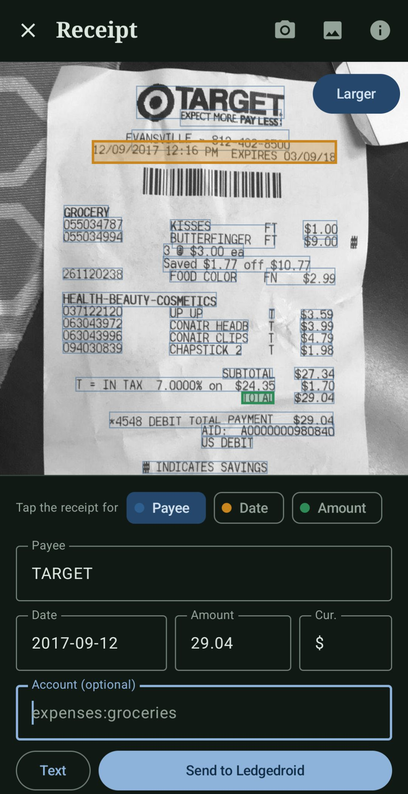
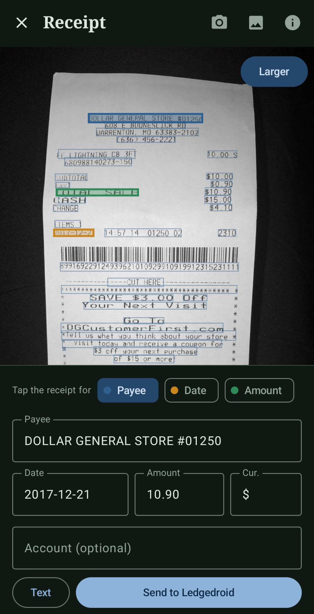
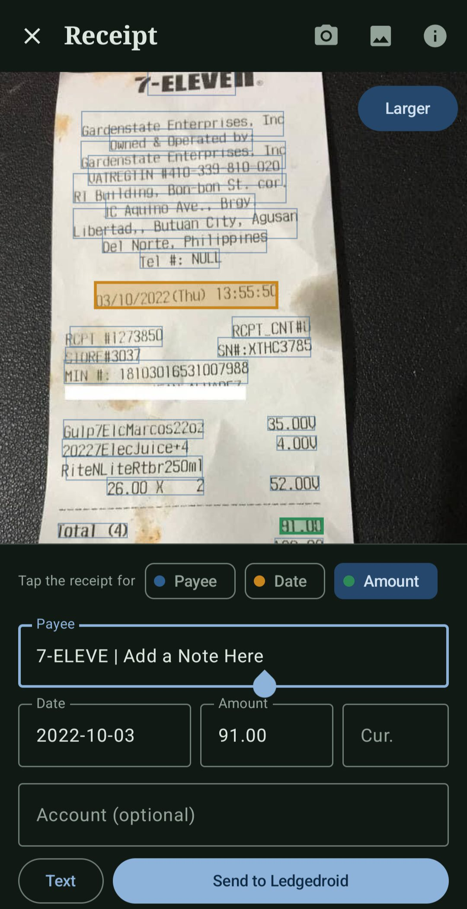

<p align="center">
  
</p>

<h1 align="center">Receiptdroid</h1>

<p align="center">
  An Android app to help you photograph a receipt, or bring in an emailed one, and send the result to the <a href="https://hledger.org">hledger</a> journals on your phone.
</p>

<p align="center">
  <a href="https://hledger.org/sponsor.html"></a>
  
  <a href="https://github.com/hnvy/receiptdroid/releases"></a>
</p>


## NOTE TO USER!
- This is to be used with [Ledgedroid](https://github.com/hnvy/ledgedroid).
- If Receiptdroid is useful to you, please consider [sponsoring
  hledger](https://hledger.org/sponsor.html).
- Receiptdroid is not affiliated with hledger.
- The app icon was drawn using the beautiful
  [Aseprite](https://www.aseprite.org/). Buy it and you won't regret
  it!
- **In addition to GPL 3.0, finances generated from this project and
  its forks MUST go to hledger.**

## Is this... AI?

Please see
[here](https://github.com/hnvy/ledgedroid/tree/main#is-this-ai).

## Quick glance

<table>
  <tr>
    <td align="center" width="25%"><br><sub>Target</sub></td>
    <td align="center" width="25%"><br><sub>Dollar General</sub></td>
    <td align="center" width="25%"><br><sub>7-Eleven (was probably found at the bottom of your bag)</sub></td>
  </tr>
</table>

## How to use it

You can take several photos (the camera reopens after each until you
go back from it), choose several from the gallery, or share several at
once. They wait in a queue and are read in turn, the next one in the
background while you check the current one. Send one, save it in
Ledgedroid, come back, and the next is ready.

The title shows how many more are waiting. Going back keeps the rest
for later, even if the phone closes the app; the bin icon discards the
current one.  After sending, "Send again" (when you come back)
re-sends the last entry, if you cancelled it in Ledgedroid.

For emailed receipts, any of these works:
- Share the email from your mail app (text or HTML), or select its
  text and share that;
- copy the email's text and tap **Paste text**;
- share or open its PDF attachment with Receiptdroid, or choose it
  with **Choose a PDF**.

**Settings** (the gear icon) has two switches:
- **Tidy payee names** (on by default): "CORNER CAFE LTD" becomes
  "Corner Cafe"; branch numbers, "Store 3297", Ltd/GmbH/Inc and ALL
  CAPITALS are tidied. When you correct a name before sending, that
  correction is remembered for the shop's next receipt. "As printed"
  under the payee box puts the receipt's own text back.
- **Suggest from my journal** (off by default): choose your journal
  file(s) once. Payees like the one read are offered under the payee
  box, and accounts under the account box, with that payee's usual
  account first (the first account of its latest transaction). With
  tidying on as well, a name your journal already has is spelt as your
  journal spells it. Files your journal `include`s aren't opened on
  their own: choose them too.

## Choosing the OCR engine

|                     | ML Kit                              | Tesseract                                  |
|---------------------|-------------------------------------|--------------------------------------------|
| Source              | closed (Google)                     | open (Apache 2.0)                          |
| Accuracy on photos  | better, especially poor photos      | good once text is large enough (see below) |
| Speed               | quick                               | a few seconds on a phone                   |
| Languages           | Latin script                        | English; add any `.traineddata` file       |
| Network             | none (its logging is cut off)       | none                                       |
| Library from        | Google's Maven                      | JitPack (`cz.adaptech.tesseract4android`)  |

## Offline and private

- **No network access at all!** Both engines' models are inside the APK:
  nothing is downloaded, and neither needs Google Play services. ML
  Kit also brings Google's usage logging, which asks for `INTERNET`
  and `ACCESS_NETWORK_STATE`. The manifest removes both (and the Wi-Fi
  ones) from the final app, so Android refuses it any connection. The
  logging can only fail; the receipt, its text and the entry never
  leave the phone. Tesseract asks for no permissions in the first
  place. God I love FOSS.
- **Receipts aren't kept.** Each receipt waiting (a photo taken, chosen
  or shared, a PDF, an email's text) is copied into the app's own
  private storage, so a batch survives the app being closed, and is
  deleted as soon as it's sent or discarded.
- **No cloud backup.** `allowBackup` is off, since the settings hold
  account names from your journal.
- **Ledgedroid is offline too:** its manifest asks only for
  notifications and starting after a reboot.  The entry goes from this
  app to Ledgedroid by Android's sharing, on the phone.

The one way text can leave the app is your choice: **Share elsewhere**
(or Send, when Ledgedroid isn't installed) hands the text to whichever
app you pick.

## What it sends and to where

It basically utilises the `Share patterns` feature in Ledgedroid (read
more
[here](https://github.com/hnvy/ledgedroid/blob/main/README.md#sharing-patterns)). It
is all in plain text, shared to Ledgedroid like any other app shares
text to it:

```
    Receipt
    Date: 2026-11-12
    Payee: Corner Cafe
    Account: expenses:food
    Amount: 12.50 USD
```

All five lines are always there, in the order of a journal entry. A
part that wasn't filled in is left empty after its label, and
Ledgedroid asks for it as usual. Only the amount is required.

| Line    | Share pattern group   | In quick add                         |
|---------|-----------------------|--------------------------------------|
| Date    | `date`                | the Date prompt's default            |
| Payee   | `payee`               | the Payee prompt's default           |
| Account | `account`             | Account 1's default                  |
| Amount  | `amount`, `currency`  | Amount 1's default                   |

Account 2 is chosen in Ledgedroid, and its amount defaults to the one
that balances.

The currency is one of `$ € £ ¥ ₹ ₩ ₺ ₽` (or a three-letter code),
which is what Ledgedroid reads. The app keeps it the way you sent it
last time when the receipt means the same currency (a receipt's `USD`
stays your `$`), so it matches the commodity your journal uses.

## Setting up Ledgedroid (once)

In Ledgedroid: Settings › Share patterns › +, name it `Receipt`, and
paste this as the pattern:

```
    Receipt\s+Date: ?(?<date>[\d-]*)\s+Payee: ?(?<payee>.*)\s+Account: ?(?<account>.*)\s+Amount: ?(?<amount>-?[\d.]+) ?(?<currency>\S*)
```

- Leave "start from a template" on None. With a template, quick add
  takes the template's payee in place of the receipt's.
- If you have other patterns, move this one first, so a looser one
  doesn't take the text before it.

The app shows these steps with a button that copies the pattern (the ⓘ
in its top bar). Without the pattern, Ledgedroid's built-in reading
still finds the date and the amount, but not the payee or account.
